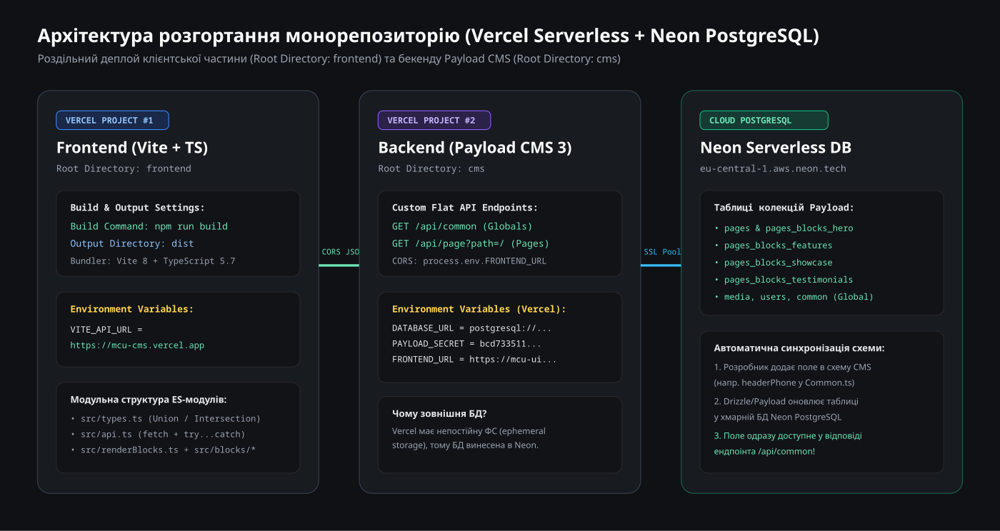
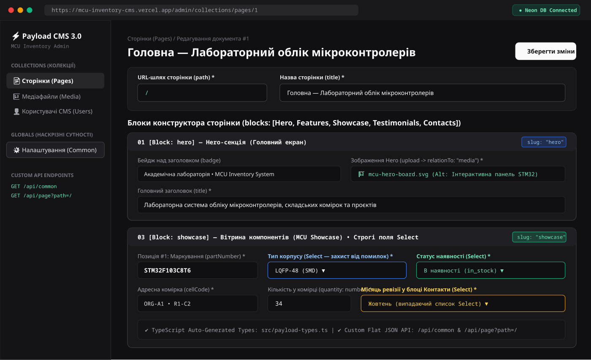
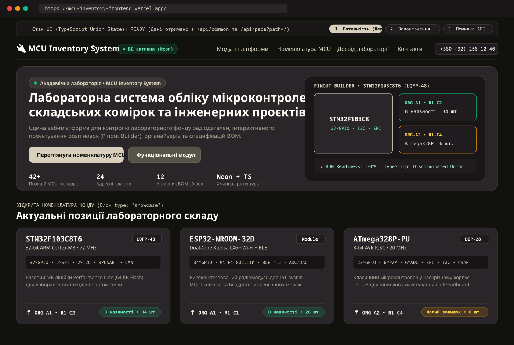
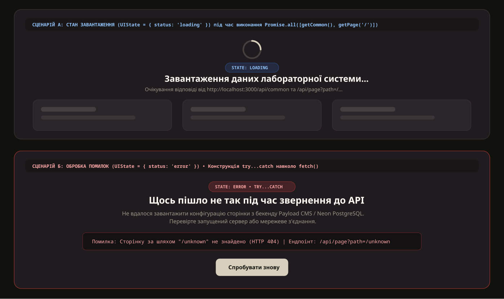

# MCU Inventory System — Презентаційний веб-ресурс (Payload CMS 3.0 + Neon PostgreSQL + Vite + TypeScript) 🔌📦

Монорепозиторій презентаційного лендінгу для лабораторної системи обліку мікроконтролерів, електронних компонентів, адресних складських комірок та специфікацій інженерних проєктів (**MCU Inventory System**), побудований за headless-архітектурою з використанням **Payload CMS 3.0**, хмарної СУБД **Neon PostgreSQL**, збірника **Vite** та суворої типізації **TypeScript**.

---

## 📑 Зміст представлення проєкту за вимогами

1. [3.1. Архітектура та Payload CMS](#31-архітектура-та-payload-cms)
2. [3.2. Клієнтська частина та стани UI](#32-клієнтська-частина-та-стани-ui)
3. [3.3. Типізація на TypeScript](#33-типізація-на-typescript)
4. [3.4. Деплой та контрольний приклад](#34-деплой-та-контрольний-приклад)
5. [Інструкція зі швидкого локального запуску](#-інструкція-зі-швидкого-локального-запуску)

---

## 3.1. Архітектура та Payload CMS

### Монорепозиторій та структура директорій

Проєкт організовано за архітектурою **монорепозиторію**, де в одному Git-репозиторії ізольовано зберігаються серверна частина керування контентом (`cms/`), клієнтський застосунок (`frontend/`), легковаговий локальний API-сервер (`backend/`) та інтерактивна візуалізація анатомії блоків (`example/`):

```text
mcu_inventory-TS/
├── cms/                          # Бекенд на базі Payload CMS 3.0 + Next.js + TypeScript
│   ├── src/
│   │   ├── blocks/               # Схеми блоків конструктора сторінок
│   │   │   ├── Hero.ts           # Блок головного екрана (заголовок, кнопки, KPI, фото)
│   │   │   ├── Features.ts       # Блок функціональних модулів лабораторії
│   │   │   ├── Showcase.ts       # Вітрина мікроконтролерів (STM32, ESP32, RP2040, AVR)
│   │   │   ├── Testimonials.ts   # Блок відгуків викладачів та інженерів
│   │   │   └── Contacts.ts       # Контакти лабораторії та кроки підключення (Onboarding)
│   │   ├── collections/          # Таблиці (колекції) бази даних у Payload CMS
│   │   │   ├── Pages.ts          # Колекція сторінок із конструктором блоків
│   │   │   ├── Media.ts          # Колекція медіафайлів та зображень компонентів
│   │   │   └── Users.ts          # Колекція адміністраторів та редакторів CMS
│   │   ├── globals/
│   │   │   └── Common.ts         # Наскрізні елементи сайту (Хедер, Меню, Статус БД, Футер)
│   │   ├── endpoints.ts          # Кастомні плоскі API-маршрути (/api/common та /api/page)
│   │   ├── payload.config.ts     # Головний конфігураційний файл Payload CMS
│   │   └── payload-types.ts      # Автоматично згенеровані TypeScript-інтерфейси БД
│   ├── .env.example              # Шаблон змінних оточення для підключення до Neon DB
│   └── package.json              # Залежності та скрипти запуску CMS
├── frontend/                     # Клієнтська частина (Vite + Vanilla TypeScript)
│   ├── public/
│   │   ├── favicon.svg           # Іконка застосунку
│   │   └── mcu-hero-board.svg    # Інтерактивна схема розпіновки STM32 та органайзера
│   ├── src/
│   │   ├── blocks/               # Модульні шаблони секцій та їхні таблиці стилів
│   │   │   ├── hero.ts / hero.css
│   │   │   ├── features.ts / features.css
│   │   │   ├── showcase.ts / showcase.css
│   │   │   ├── testimonials.ts / testimonials.css
│   │   │   └── contacts.ts / contacts.css
│   │   ├── layout/               # Шаблони наскрізних елементів (header.ts, footer.ts)
│   │   ├── styles/
│   │   │   └── base.css          # Базові змінні Refined Palette Theme та адаптивна сітка
│   │   ├── types.ts              # Повна система типів (Aliases, Union, Intersection, Generics)
│   │   ├── api.ts                # Типізовані асинхронні HTTP-запити до бекенду
│   │   ├── renderBlocks.ts       # Динамічний диспетчер рендерингу блоків за полем type
│   │   └── main.ts               # Точка входу та керування станами (Loading / Error / Ready)
│   ├── index.html                # Кореневий HTML-контейнер (#app)
│   ├── tsconfig.json             # Сувора конфігурація компілятора TypeScript
│   └── package.json              # Маніфест фронтенд-застосунку
├── backend/                      # Допоміжний Express REST API сервер із демо-даними JSON
│   ├── data/
│   │   ├── common.json           # Дані наскрізних налаштувань сайту
│   │   └── pages.json            # Структура блоків головної сторінки MCU Inventory
│   └── server.js                 # Маршрути /api/common та /api/page?path=... з підтримкою CORS
├── example/
│   └── landing-anatomy.html      # Інтерактивна анатомія полів і блоків сторінки
├── docs/
│   └── screenshots/              # Скріншоти контрольного прикладу (CMS, Сайт, Помилки, Деплой)
└── package.json                  # Кореневий маніфест монорепозиторію з кастомними скриптами
```

### Конфігурація Payload CMS (`cms/src/payload.config.ts`)

Адмін-панель **Payload CMS** генерується повністю автоматично на основі написаних кодом схем та конфігураційних файлів у папці `cms/src/`, тому її не потрібно верстати вручну.
- **Колекції (`collections`)**: структурують таблиці в реляційній базі даних та правила доступу до них:
  - `Pages` (`cms/src/collections/Pages.ts`) — зберігає URL-шлях сторінки (`path`, за замовчуванням `"/"`), заголовок (`title`) та масив динамічних блоків (`blocks: [Hero, Features, Showcase, Testimonials, Contacts]`).
  - `Media` (`cms/src/collections/Media.ts`) — відповідає за завантаження зображень мікроконтролерів і схем (`upload: true`) з обов'язковим атрибутом доступності `alt` та кодом компонента `componentCode`.
  - `Users` (`cms/src/collections/Users.ts`) — колекція авторизації адміністраторів та викладачів лабораторії (`auth: true`).
- **Наскрізні сутності (`Globals` — `cms/src/globals/Common.ts`)**: загальні елементи сайту — назва платформи (`siteName`), телефон лабораторії в шапці (`headerPhone`), статус бази даних (`dbStatus`), головне навігаційне меню (`menu`) та футер (`footer`) — винесені в окрему сутність `Globals`, оскільки вони є наскрізними для всього ресурсу і не прив'язані до конкретної сторінки.
- **Конструктор блоків (`blocks`) та захист від помилок вводу**: нові блоки для конструктора створюються шляхом опису схем полів у `cms/src/blocks/`. Чіткий ввід даних в адмінці забезпечується налаштуванням **строгих типів полів**: наприклад, випадаючі списки `select` замість довільного тексту використовуються для вибору місяця ревізії складу (`activeMonth`: Вересень..Червень у `Contacts.ts`), типу корпусу мікросхеми (`packageType`: `LQFP-48`, `QFN-56`, `DIP-28`, `SOIC-8`, `Module` у `Showcase.ts`), статусу наявності (`stockStatus`: `in_stock`, `low_stock`, `reserved`) та стилю кнопок (`variant`: `primary`, `secondary`, `ghost` у `Hero.ts`). Це унеможливлює людські помилки редактора.

### Хмарна БД Neon PostgreSQL та кастомні API-ендпоінти

- **Зовнішня хмарна СУБД Neon (`@payloadcms/db-postgres`)**: підключення налаштовується через адаптер `postgresAdapter` із передачею рядка підключення `process.env.DATABASE_URL`. Коли розробник розширює схему в CMS (наприклад, додає поле `headerPhone` у глобальну схему `Common.ts`), Payload CMS під капотом автоматично оновлює структуру таблиць у базі даних Neon, генерує оновлені TypeScript-інтерфейси у `payload-types.ts`, а нове поле миттєво стає доступним у відповідях API.
- **Кастомні плоскі маршрути `/api/common` та `/api/page?path=` (`cms/src/endpoints.ts`)**: стандартний REST API Payload повертає надто складну і глибоко вкладену структуру із службовими метаданими. Тому у файлі `cms/src/endpoints.ts` реалізовані кастомні ендпоінти:
  - `GET /api/common` (та аліас `/api/settings`) — повертає чистий JSON наскрізних налаштувань сайту (`siteName`, `headerPhone`, `dbStatus`, `menu`, `footer`).
  - `GET /api/page?path=/` (та аліас `/api/pages?path=/`) — шукає сторінку за параметром `path`, нормалізує `blockType` у плоске поле `type`, перетворює вкладені об'єкти колекції `Media` у `{ src, alt }` і повертає чистий, готовий до рендерингу масив блоків.
- **Політики CORS**: для безпечної взаємодії між різними доменами (коли фронтенд і CMS задеплоєні на окремих адресах або працюють на різних портах `localhost:5173` і `localhost:3000`) на бекенді налаштовані політики `cors`, які дозволяють браузеру виконувати крос-доменні запити без блокування.

---

## 3.2. Клієнтська частина та стани UI

### Модульна архітектура (Vite + ES-модулі) та життєвий цикл запиту

Клієнтська частина (`frontend/`) реалізована за модульним підходом на основі стандартних **ES-модулів (`import` / `export`)**, а збирання, транспiляцію TypeScript та гаряче перезавантаження (HMR) забезпечує збірник **Vite**.

**Повний життєвий цикл запиту:**
1. Відвідувач відкриває сторінку в браузері (наприклад, `/`).
2. Скрипт `frontend/src/main.ts` переводить інтерфейс у стан **завантаження (`loading`)**, зчитує поточний `location.pathname` і паралельно через `Promise.all([getCommon(), getPage(currentPath)])` відправляє асинхронні HTTP-запити до `/api/common` та `/api/page?path=/`.
3. Бекенд звертається до бази даних, формує чистий JSON та повертає об'єкт налаштувань і масив блоків сторінки.
4. Диспетчер `frontend/src/renderBlocks.ts` проганяє масив `page.blocks`: для кожного об'єкта за дискримінатором `block.type` (`"hero"`, `"features"`, `"showcase"`, `"testimonials"`, `"contacts"`) викликається відповідна функція-шаблонізатор із папки `frontend/src/blocks/`, після чого готовий HTML вставляється у DOM-контейнер `#app`.

### Шаблонізація блоків та адаптивна верстка

Нові секції сайту додаються шляхом створення окремого шаблону у папці `frontend/src/blocks/` та його реєстрації у словнику `renderers` у файлі `frontend/src/renderBlocks.ts`:
- `hero.ts` — рендерить головний банер лабораторії, кнопки дій, KPI-показники та візуалізацію розпіновки мікроконтролера `STM32F103C8T6`.
- `features.ts` — рендерить картки чотирьох модулів системи (`Каталог та Pinout Builder`, `Адресний складський облік`, `Специфікації проєктів (BOM)`, `Безпека та пре-модерація`).
- `showcase.ts` — рендерить вітрину реальних компонентів складу (`STM32F103C8T6`, `ESP32-WROOM-32D`, `RP2040`, `ATmega328P-PU`, `BME280`, `INA219`) із корпусами, шинами та колірними індикаторами запасу в комірках органайзера.
- `testimonials.ts` — рендерить відгуки викладачів та інженерів лабораторії із зірковим рейтингом (`★`).
- `contacts.ts` — рендерить 3 кроки підключення до системи (Onboarding), прямі контакти (`tel:`, `mailto:`) та поточний місяць ревізії складу.

Верстка виконана у фірмовій колірній палітрі **MCU Inventory System (Refined Palette Theme: Smoky Black `#11120D`, Charcoal `#2A2529`, Olive Drab `#565449`, Bone `#D8CFBC`, Floral White `#FFFBF4`)** із використанням CSS Grid, Flexbox, флюїдної типографіки `clamp()` та медіа-запитів `@media (min-width: 768px)` і `@media (min-width: 1080px)` для повної адаптивності на смартфонах, планшетах і десктопах.

### Обробка станів UI (Завантаження / Помилка / Готовність)

У файлі `frontend/src/main.ts` асинхронні запити `fetch` обгорнуті у конструкцію `try...catch`, що забезпечує відображення трьох чітких станів інтерфейсу:
1. **Стан завантаження (`status: 'loading'`)** — відображається анімований індикатор обертання (spinner), статусний бейдж `STATE: LOADING` та skeleton-картки очікування відповіді від API.
2. **Стан готовності (`status: 'ready'`)** — оновлюється `document.title` вкладки браузера, рендериться шапка (`header.ts`), динамічні блоки (`renderBlocks.ts`) та підвал сайту (`footer.ts`).
3. **Стан помилки (`status: 'error'`)** — у разі мережевого збою, вимкненого бекенду або звернення до неіснуючого маршруту (`HTTP 404 / 503`) замість критичного падіння додатка користувачеві виводиться інформативне вікно **«Щось пішло не так під час звернення до API»** із текстом помилки, адресою ендпоінта та кнопкою **«Спробувати знову»**.

---

## 3.3. Типізація на TypeScript

Уся клієнтська частина (`frontend/src/*.ts`) та конфігурація CMS (`cms/src/*.ts`) повністю типізовані на **TypeScript** (перевірка виконується командою `npm run typecheck` / `tsc --noEmit`). Центральним файлом типізації фронтенду є `frontend/src/types.ts`:

### 1. Використання Type Aliases та літеральних Union Types (`|`)

```ts
export type PagePath = string;
export type SectionAnchor = string;

export type ButtonVariant = 'primary' | 'secondary' | 'ghost';
export type DbHealthStatus = 'online' | 'maintenance' | 'offline';
export type PackageType = 'LQFP-48' | 'QFN-56' | 'DIP-28' | 'SOIC-8' | 'Module';
export type StockStatus = 'in_stock' | 'low_stock' | 'reserved';
export type RatingValue = 1 | 2 | 3 | 4 | 5;
```

### 2. Використання Intersection Types (`&`) для композиції схем блоків

Спільні ідентифікаційні (`BlockIdentity`) та заголовкові (`BlockHeading`) поля об'єднуються через оператор перетину типів `&` у базовий тип `BaseSectionBlock`, після чого кожен блок сторінки розширює його власними полями:

```ts
export type BlockIdentity = {
  id?: string;
  anchor?: SectionAnchor;
};

export type BlockHeading = {
  badge?: string;
  title: string;
  subtitle?: string;
};

// Intersection Type (&): поєднання ідентифікатора та заголовка секції
export type BaseSectionBlock = BlockIdentity & BlockHeading;

// Схеми конкретних блоків через Intersection Types
export type HeroBlock = BaseSectionBlock & {
  type: 'hero';
  image: MediaImage;
  buttons: ActionButton[];
  metrics?: HeroMetric[];
};

export type ShowcaseBlock = BaseSectionBlock & {
  type: 'showcase';
  items: ComponentShowcaseItem[];
};
```

### 3. Дискриміновані Union Types (`|`) для блоків сторінки та станів UI

```ts
// Об'єднаний тип (Discriminated Union) усіх можливих блоків сторінки за полем `type`
export type PageBlock =
  | HeroBlock
  | FeaturesBlock
  | ShowcaseBlock
  | TestimonialsBlock
  | ContactsBlock;

export type BlockType = PageBlock['type'];

// Дискримінований Union Type для трьох станів UI (Завантаження / Готовність / Помилка)
export type UIState<T> =
  | { status: 'loading'; message: string }
  | { status: 'ready'; data: T }
  | { status: 'error'; errorMessage: string; endpointUrl: string };
```

### 4. Типізація функцій, об'єктів та даних, отриманих через API

У файлах `frontend/src/types.ts`, `frontend/src/api.ts` та `frontend/src/renderBlocks.ts` суворо типізовані як функції запитів до API, так і реєстр рендерерів блоків:

```ts
// Типізація даних, отриманих через API (/api/common та /api/page)
export type CommonSettings = {
  siteName: string;
  headerPhone?: string;
  dbStatus?: DbHealthStatus;
  menu: MenuItem[];
  footer: FooterSettings;
};

export type PageData = {
  path: PagePath;
  title: string;
  blocks: PageBlock[];
};

// Узагальнений (Generic) тип функції-шаблонізатора та словника рендерерів
export type BlockRenderer<B extends PageBlock = PageBlock> = (block: B) => string;

export type BlockRendererRegistry = {
  [K in BlockType]: BlockRenderer<Extract<PageBlock, { type: K }>>;
};

// Узагальнена типізована функція запиту до API (src/api.ts)
export const getJson: ApiGetFunction = async <T>(endpoint: string): Promise<T> => {
  const response: Response = await fetch(`${API_URL}${endpoint}`);
  if (!response.ok) {
    throw new Error(`HTTP status: ${response.status}`);
  }
  return (await response.json()) as T;
};
```

---

## 3.4. Деплой та контрольний приклад

### Інфраструктура розгортання (Node.js, Git, Vercel, Neon PostgreSQL)

1. **Керування пакетами та `package.json`**:
   - Проєкт ініціалізується командою `npm init -y`, яка утворює маніфест `package.json`.
   - Залежності поділяються на `dependencies` (модулі, необхідні для роботи додатка у продакшені: `payload`, `next`, `@payloadcms/db-postgres`, `react`, `express`, `cors`) та `devDependencies` (інструменти етапу збірки та локальної розробки: `vite`, `typescript`, `eslint`, `vitest`).
   - У секції `scripts` прописані як стандартні команди (`dev`, `build`, `typecheck`), так і кастомні аліаси (наприклад, `npm run mcu-start`).
   - Папка `node_modules/` та файли `.env` внесені до `.gitignore` і ніколи не відвантажуються на GitHub (залежності відновлюються на сервері командою `npm install`).
2. **Чому використовується хмарна СУБД Neon PostgreSQL**:
   - Хостинг **Vercel** функціонує за серверлес-архітектурою (Serverless Functions) і має **непостійну файлову систему (ephemeral storage)**, яка очищається при кожному перезапуску контейнерів. Тому підняти локальну реляційну БД або зберігати SQLite всередині Vercel неможливо.
   - Як надійне сховище обрано зовнішню хмарну СУБД **Neon Serverless PostgreSQL**, підключення до якої передається через змінну оточення `DATABASE_URL`.
3. **Алгоритм деплою монорепозиторію на Vercel**:
   - До Vercel підключається GitHub-репозиторій проєкту, після чого створюються два окремі проєкти з явно вказаним **Root Directory**:
     - **Проєкт №1 (`cms`)**: `Root Directory = cms`. У панель *Environment Variables* переносяться змінні `DATABASE_URL`, `PAYLOAD_SECRET`, `CMS_URL` та `FRONTEND_URL`.
     - **Проєкт №2 (`frontend`)**: `Root Directory = frontend`, команда збірки `npm run build` (Vite транспілює TypeScript-модулі, стискає ресурси й формує статичні файли в папці `dist/`). У *Environment Variables* задається `VITE_API_URL` із посиланням на задеплоєну CMS.



---

### Контрольний приклад із скріншотами

#### 1. Робота редактора в адмін-панелі Payload CMS (`/admin`)
Адміністратор або викладач лабораторії відкриває колекцію **«Сторінки (Pages)»** у Payload CMS, редагує головну сторінку (`path: "/"`), наповнює конструктор блоків (`Hero`, `Features`, `Showcase`, `Testimonials`, `Contacts`) і обирає значення із захищених випадаючих списків `Select` (корпус `LQFP-48`, статус `in_stock`, місяць ревізії `Жовтень`):



#### 2. Відображення сторінки для відвідувача на сайті (Стан готовності — `Ready`)
При відкритті сайту клієнтський застосунок виконує асинхронні запити до `/api/common` та `/api/page?path=/`, отримує чистий JSON, підставляє дані в типізовані шаблони блоків і рендерить адаптивну сторінку презентації **MCU Inventory System**:



#### 3. Обробка станів завантаження (`Loading`) та помилок мережі / API (`Error` через `try...catch`)
Під час очікування відповіді від сервера відвідувач бачить індикатор завантаження та skeleton-картки (`STATE: LOADING`). Якщо бекенд недоступний або запитано неіснуючу сторінку (`/api/page?path=/unknown`), конструкція `try...catch` перехоплює виняток і замість падіння інтерфейсу відображає інформативну картку помилки **«Щось пішло не так під час звернення до API»** із кнопкою повторної спроби:



---

## 🚀 Інструкція зі швидкого локального запуску

### Варіант А: Швидкий запуск Фронтенду (Vite + TS) з легковаговим API-сервером (`backend/`)

1. **Запуск локального API-сервера на порту `3000`**:
   ```bash
   cd backend
   npm install
   npm run dev
   ```
   Сервер запускається на `http://localhost:3000` і віддає ендпоінти:
   - `http://localhost:3000/api/common`
   - `http://localhost:3000/api/page?path=/`

2. **Запуск клієнтської частини (Vite + TypeScript) на порту `5173`**:
   ```bash
   cd frontend
   npm install
   npm run typecheck   # Перевірка суворої типізації TypeScript (tsc --noEmit)
   npm run dev         # Запуск dev-сервера Vite на http://localhost:5173
   ```

3. **Збірка продакшн-бандлу фронтенду в папку `dist/`**:
   ```bash
   cd frontend
   npm run build
   ```

### Варіант Б: Повний запуск із Payload CMS 3.0 та хмарною БД Neon (`cms/`)

1. Створіть файл `cms/.env` на основі `cms/.env.example` і вкажіть `DATABASE_URL` вашої бази даних **Neon PostgreSQL** та `PAYLOAD_SECRET`.
2. Запустіть сервер розробки Payload CMS:
   ```bash
   cd cms
   npm install
   npm run dev
   ```
   - Адмін-панель Payload CMS: `http://localhost:3000/admin`
   - Кастомні плоскі ендпоінти CMS: `http://localhost:3000/api/common` та `http://localhost:3000/api/page?path=/`
